# Self-golden review sheet (05 V12 step 3)

Every committed reference in `wgpu/linux-lavapipe/` (302 images), grouped by family, with its render-check case name.
Tick each case once judged correct by eye; compare with the case's spec (golden model / probes) in
`target/render-check/linux-lavapipe/report.md` from `cargo run -p render-check --release -- --out target/render-check`.

Contents: [brush](#brush) (6), [clip](#clip) (25), [effect](#effect) (11), [frag](#frag) (2), [grad](#grad) (25), [img](#img) (28), [layer](#layer) (39), [mesh](#mesh) (3), [prim](#prim) (19), [screen](#screen) (10), [shadow](#shadow) (14), [sprite](#sprite) (2), [stress](#stress) (4), [stroke](#stroke) (50), [text](#text) (40), [widget](#widget) (17), [xform](#xform) (7)

## brush

| ok | case | size | bytes | image |
|---|---|---|---|---|
| [ ] | `brush/image_fill_repeat` | 128×128 | 1916 | 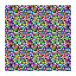 |
| [ ] | `brush/image_fill_rrect_reflect` | 128×128 | 7295 | 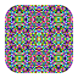 |
| [ ] | `brush/image_stroke` | 128×128 | 6797 | 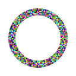 |
| [ ] | `brush/shader_rings_stroke` | 128×128 | 7124 | 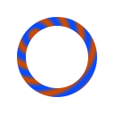 |
| [ ] | `brush/shader_star_uniforms` | 128×128 | 2862 |  |
| [ ] | `brush/shader_uv_rect` | 128×128 | 482 | 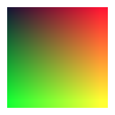 |

## clip

| ok | case | size | bytes | image |
|---|---|---|---|---|
| [ ] | `clip/circle` | 128×128 | 2525 |  |
| [ ] | `clip/clip_inside_opacity` | 240×200 | 3610 |  |
| [ ] | `clip/donut_evenodd` | 128×128 | 3490 |  |
| [ ] | `clip/ellipse` | 128×128 | 2143 |  |
| [ ] | `clip/huge_rotated` | 640×640 | 7773 |  |
| [ ] | `clip/nested_depth8` | 128×128 | 732 |  |
| [ ] | `clip/nested_paths_3` | 128×128 | 2167 |  |
| [ ] | `clip/oval_widget` | 240×160 | 3958 | 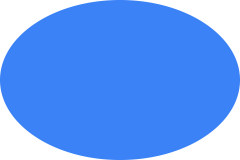 |
| [ ] | `clip/path_star` | 128×128 | 2902 |  |
| [ ] | `clip/path_star_evenodd` | 128×128 | 3518 |  |
| [ ] | `clip/rect_fractional` | 128×128 | 485 |  |
| [ ] | `clip/rect_fractional_s125` | 160×160 | 577 |  |
| [ ] | `clip/rect_fractional_s150` | 192×192 | 677 |  |
| [ ] | `clip/rect_fractional_s175` | 224×224 | 912 |  |
| [ ] | `clip/rect_fractional_s200` | 256×256 | 997 |  |
| [ ] | `clip/rect_negative_origin` | 128×128 | 336 |  |
| [ ] | `clip/rect_rotated` | 128×128 | 2443 |  |
| [ ] | `clip/rect_scissor` | 128×128 | 366 |  |
| [ ] | `clip/rotated_rect_30` | 128×128 | 3077 |  |
| [ ] | `clip/rrect` | 128×128 | 1512 |  |
| [ ] | `clip/rrect_in_rrect` | 128×128 | 700 |  |
| [ ] | `clip/rrect_overlap_edge` | 128×128 | 1150 |  |
| [ ] | `clip/rrect_zero_radius` | 128×128 | 366 |  |
| [ ] | `clip/scroll_viewport` | 240×200 | 3859 | 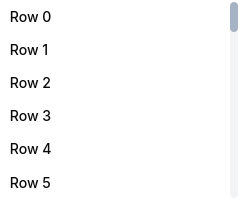 |
| [ ] | `clip/volatile_path` | 128×128 | 1658 |  |

## effect

| ok | case | size | bytes | image |
|---|---|---|---|---|
| [ ] | `effect/backdrop_frosted` | 128×96 | 868 |  |
| [ ] | `effect/backdrop_nested` | 128×96 | 432 |  |
| [ ] | `effect/blur_square` | 128×96 | 2466 |  |
| [ ] | `effect/blur_text` | 128×96 | 3179 |  |
| [ ] | `effect/chain_blur_matrix` | 128×96 | 1185 |  |
| [ ] | `effect/color_matrix_alpha_offset` | 128×96 | 273 |  |
| [ ] | `effect/color_matrix_grayscale` | 128×96 | 260 |  |
| [ ] | `effect/dilate` | 128×96 | 1061 |  |
| [ ] | `effect/erode` | 128×96 | 301 |  |
| [ ] | `effect/perspective_card` | 128×96 | 711 |  |
| [ ] | `effect/perspective_text` | 128×96 | 2191 |  |

## frag

| ok | case | size | bytes | image |
|---|---|---|---|---|
| [ ] | `frag/append_twice` | 128×128 | 1858 |  |
| [ ] | `frag/nested_transforms` | 128×128 | 2281 |  |

## grad

| ok | case | size | bytes | image |
|---|---|---|---|---|
| [ ] | `grad/brush_transform_rotate30` | 128×128 | 6912 |  |
| [ ] | `grad/decoration_gradient_rrect` | 160×120 | 5830 |  |
| [ ] | `grad/degenerate` | 128×128 | 360 |  |
| [ ] | `grad/gradient_text` | 200×64 | 4650 |  |
| [ ] | `grad/hard_stops` | 128×128 | 300 | 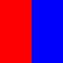 |
| [ ] | `grad/interpolation_cs` | 128×128 | 1487 | 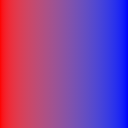 |
| [ ] | `grad/linear_alpha_stops` | 128×128 | 946 | 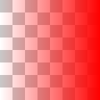 |
| [ ] | `grad/linear_multistop` | 128×128 | 1372 |  |
| [ ] | `grad/linear_pad` | 128×128 | 1120 |  |
| [ ] | `grad/linear_reflect` | 128×128 | 1284 |  |
| [ ] | `grad/linear_repeat` | 128×128 | 927 |  |
| [ ] | `grad/radial_focal_on_circle` | 128×128 | 5745 |  |
| [ ] | `grad/radial_pad` | 128×128 | 3067 |  |
| [ ] | `grad/radial_reflect` | 128×128 | 15103 | 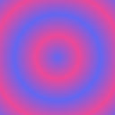 |
| [ ] | `grad/radial_repeat` | 128×128 | 14863 |  |
| [ ] | `grad/radial_strip` | 128×128 | 2390 |  |
| [ ] | `grad/stroke_gradient` | 128×128 | 4907 |  |
| [ ] | `grad/sweep_negative_start` | 128×128 | 7701 |  |
| [ ] | `grad/sweep_pad` | 128×128 | 6048 |  |
| [ ] | `grad/sweep_reflect` | 128×128 | 10890 |  |
| [ ] | `grad/sweep_repeat` | 128×128 | 10746 | 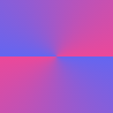 |
| [ ] | `grad/two_point_pad` | 128×128 | 5775 | 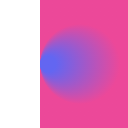 |
| [ ] | `grad/two_point_reflect` | 128×128 | 14280 | 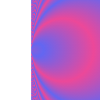 |
| [ ] | `grad/two_point_repeat` | 128×128 | 14477 |  |
| [ ] | `grad/unpremul_alpha` | 128×128 | 1716 | 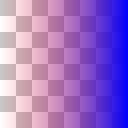 |

## img

| ok | case | size | bytes | image |
|---|---|---|---|---|
| [ ] | `img/aligned_1x` | 128×128 | 392 |  |
| [ ] | `img/bgra8_source` | 128×128 | 25733 | 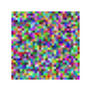 |
| [ ] | `img/brush_alpha_0_5` | 128×128 | 391 |  |
| [ ] | `img/brush_fill_alpha_0_5` | 64×64 | 196 |  |
| [ ] | `img/brush_fill_pad` | 64×64 | 177 |  |
| [ ] | `img/brush_fill_reflect` | 64×64 | 194 |  |
| [ ] | `img/brush_fill_repeat` | 64×64 | 198 | 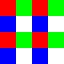 |
| [ ] | `img/brush_stroke` | 64×64 | 691 |  |
| [ ] | `img/brush_transform_rotate` | 64×64 | 914 | 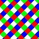 |
| [ ] | `img/dynamic_update` | 128×128 | 25705 | 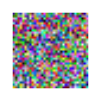 |
| [ ] | `img/edge_sampling` | 128×128 | 8436 | 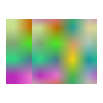 |
| [ ] | `img/fit_cover_rrect` | 200×120 | 1411 |  |
| [ ] | `img/many_200_distinct` | 256×256 | 183002 | 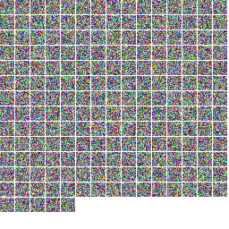 |
| [ ] | `img/minify_checker_high` | 128×128 | 323 |  |
| [ ] | `img/minify_checker_medium` | 128×128 | 323 |  |
| [ ] | `img/nine_slice_button` | 128×128 | 394 |  |
| [ ] | `img/nonuniform_scale` | 128×128 | 13869 | 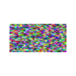 |
| [ ] | `img/premultiplied_alpha` | 128×128 | 23477 |  |
| [ ] | `img/quality_low_nearest` | 128×128 | 762 | 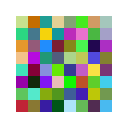 |
| [ ] | `img/rotated_30` | 128×128 | 6152 |  |
| [ ] | `img/scaled_down_quarter` | 128×128 | 412 |  |
| [ ] | `img/scaled_up_3x` | 128×128 | 6698 |  |
| [ ] | `img/scaled_up_3x_s125` | 160×160 | 10097 |  |
| [ ] | `img/scaled_up_3x_s150` | 192×192 | 14034 |  |
| [ ] | `img/scaled_up_3x_s175` | 224×224 | 17963 |  |
| [ ] | `img/scaled_up_3x_s200` | 256×256 | 22776 | 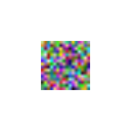 |
| [ ] | `img/straight_alpha` | 128×128 | 23477 | 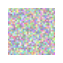 |
| [ ] | `img/under_clip_and_opacity` | 128×128 | 1221 |  |

## layer

| ok | case | size | bytes | image |
|---|---|---|---|---|
| [ ] | `layer/blend_color` | 128×96 | 432 |  |
| [ ] | `layer/blend_color_burn` | 128×96 | 422 |  |
| [ ] | `layer/blend_color_dodge` | 128×96 | 490 |  |
| [ ] | `layer/blend_darken` | 128×96 | 398 |  |
| [ ] | `layer/blend_difference` | 128×96 | 492 |  |
| [ ] | `layer/blend_exclusion` | 128×96 | 491 |  |
| [ ] | `layer/blend_hard_light` | 128×96 | 496 |  |
| [ ] | `layer/blend_hue` | 128×96 | 433 |  |
| [ ] | `layer/blend_in_sdf_clip` | 128×96 | 1118 |  |
| [ ] | `layer/blend_inside_clip` | 128×96 | 284 |  |
| [ ] | `layer/blend_lighten` | 128×96 | 461 |  |
| [ ] | `layer/blend_luminosity` | 128×96 | 474 |  |
| [ ] | `layer/blend_multiply` | 128×96 | 432 |  |
| [ ] | `layer/blend_normal` | 128×96 | 428 |  |
| [ ] | `layer/blend_overlay` | 128×96 | 510 |  |
| [ ] | `layer/blend_saturation` | 128×96 | 456 |  |
| [ ] | `layer/blend_screen` | 128×96 | 475 |  |
| [ ] | `layer/blend_soft_light` | 128×96 | 507 |  |
| [ ] | `layer/color_filtered` | 160×120 | 343 |  |
| [ ] | `layer/compose_clear` | 128×96 | 242 |  |
| [ ] | `layer/compose_copy` | 128×96 | 1424 |  |
| [ ] | `layer/compose_dest` | 128×96 | 255 |  |
| [ ] | `layer/compose_dest_atop` | 128×96 | 1721 |  |
| [ ] | `layer/compose_dest_in` | 128×96 | 1001 |  |
| [ ] | `layer/compose_dest_out` | 128×96 | 1035 |  |
| [ ] | `layer/compose_dest_over` | 128×96 | 1098 |  |
| [ ] | `layer/compose_plus` | 128×96 | 1779 |  |
| [ ] | `layer/compose_plus_lighter` | 128×96 | 1779 |  |
| [ ] | `layer/compose_src_atop` | 128×96 | 1058 |  |
| [ ] | `layer/compose_src_in` | 128×96 | 1038 |  |
| [ ] | `layer/compose_src_out` | 128×96 | 1068 |  |
| [ ] | `layer/compose_src_over` | 128×96 | 1793 |  |
| [ ] | `layer/compose_xor` | 128×96 | 1783 |  |
| [ ] | `layer/decoration_blend` | 160×120 | 650 | 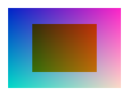 |
| [ ] | `layer/fragment_append` | 128×96 | 573 |  |
| [ ] | `layer/opacity_0_5` | 128×96 | 309 |  |
| [ ] | `layer/opacity_clip` | 128×96 | 355 |  |
| [ ] | `layer/opacity_fold_single` | 128×96 | 736 |  |
| [ ] | `layer/opacity_nested` | 128×96 | 366 |  |

## mesh

| ok | case | size | bytes | image |
|---|---|---|---|---|
| [ ] | `mesh/strip_fan` | 128×96 | 527 |  |
| [ ] | `mesh/textured` | 128×96 | 3308 |  |
| [ ] | `mesh/vertex_colors` | 128×96 | 1886 | 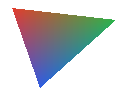 |

## prim

| ok | case | size | bytes | image |
|---|---|---|---|---|
| [ ] | `prim/circles` | 128×128 | 1988 |  |
| [ ] | `prim/circles_s125` | 160×160 | 2731 |  |
| [ ] | `prim/circles_s150` | 192×192 | 3472 | 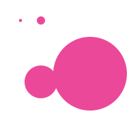 |
| [ ] | `prim/circles_s175` | 224×224 | 4213 | 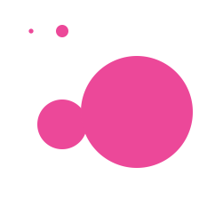 |
| [ ] | `prim/circles_s200` | 256×256 | 4960 |  |
| [ ] | `prim/curves` | 128×128 | 1805 |  |
| [ ] | `prim/donut_evenodd` | 128×128 | 2588 |  |
| [ ] | `prim/donut_nonzero` | 128×128 | 1972 |  |
| [ ] | `prim/ellipse_rotated` | 128×128 | 1703 |  |
| [ ] | `prim/icons` | 256×160 | 7090 |  |
| [ ] | `prim/many_subpaths` | 128×128 | 391 | 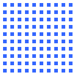 |
| [ ] | `prim/rect_aligned` | 128×128 | 319 |  |
| [ ] | `prim/rect_fractional` | 128×128 | 319 |  |
| [ ] | `prim/rect_translucent_overlap` | 128×128 | 342 |  |
| [ ] | `prim/rrect_per_corner` | 128×128 | 1096 |  |
| [ ] | `prim/rrect_radii` | 128×128 | 1549 |  |
| [ ] | `prim/slivers` | 128×128 | 312 | 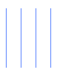 |
| [ ] | `prim/star_evenodd` | 128×128 | 2525 |  |
| [ ] | `prim/star_nonzero` | 128×128 | 2126 |  |

## screen

| ok | case | size | bytes | image |
|---|---|---|---|---|
| [ ] | `screen/app_shell` | 1200×800 | 102714 | 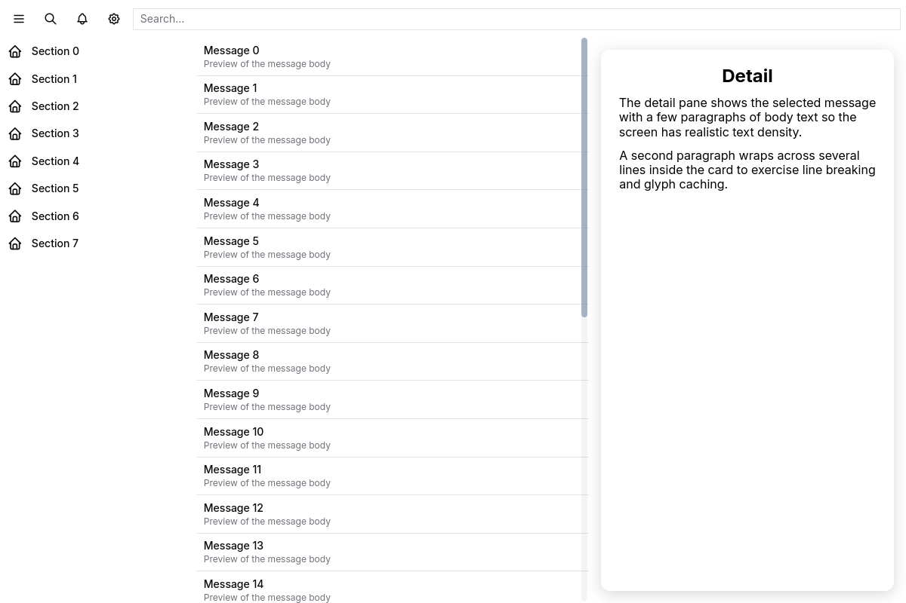 |
| [ ] | `screen/charts_like` | 900×600 | 24514 |  |
| [ ] | `screen/code_editor_like` | 900×600 | 57970 | 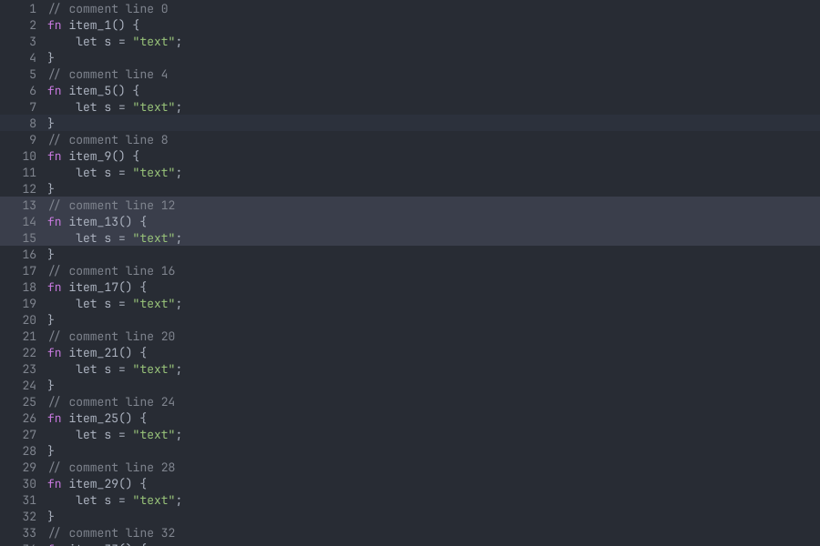 |
| [ ] | `screen/dashboard_1200x800` | 1200×800 | 191874 |  |
| [ ] | `screen/flutter_parity_article` | 800×1000 | 55716 | 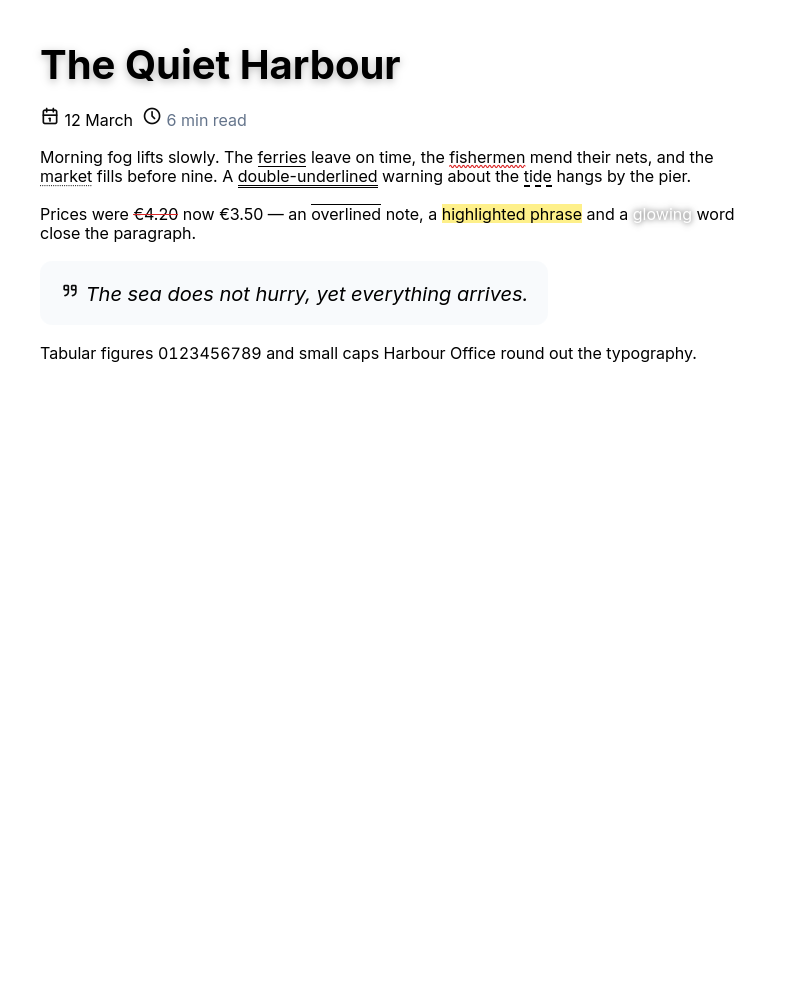 |
| [ ] | `screen/flutter_parity_card_stack` | 900×600 | 94526 | 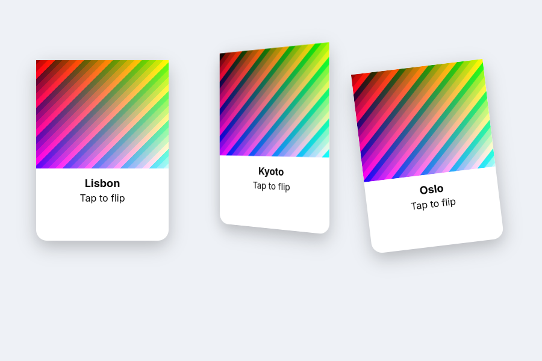 |
| [ ] | `screen/flutter_parity_frosted_app_bar` | 900×700 | 55266 | 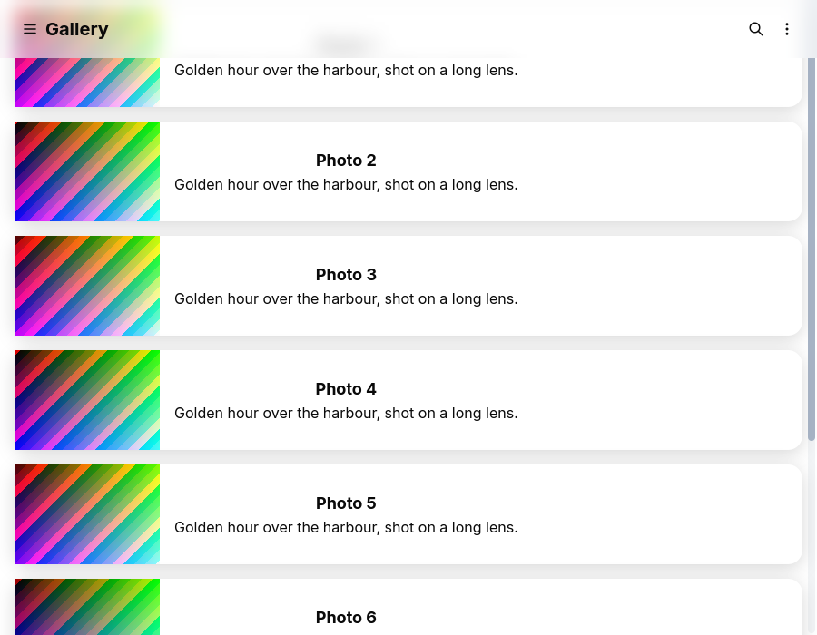 |
| [ ] | `screen/form` | 600×700 | 18682 |  |
| [ ] | `screen/landing_like` | 1200×860 | 118328 | 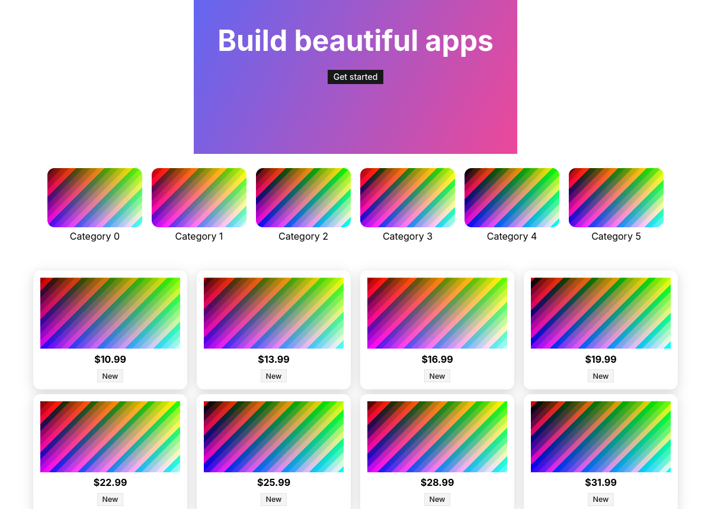 |
| [ ] | `screen/markdown_like` | 900×1000 | 32335 | 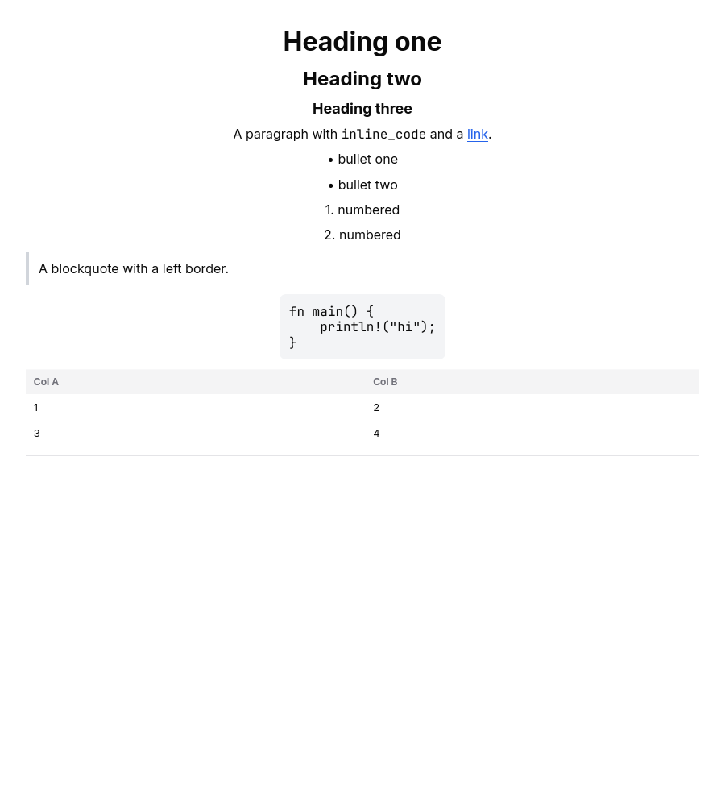 |

## shadow

| ok | case | size | bytes | image |
|---|---|---|---|---|
| [ ] | `shadow/blur_64` | 256×256 | 8401 |  |
| [ ] | `shadow/blur_min` | 128×128 | 372 |  |
| [ ] | `shadow/blurred_rect_basic` | 128×128 | 2240 |  |
| [ ] | `shadow/elevation_card` | 200×200 | 2334 |  |
| [ ] | `shadow/elevation_card_s125` | 250×250 | 3200 |  |
| [ ] | `shadow/elevation_card_s150` | 300×300 | 4076 |  |
| [ ] | `shadow/elevation_card_s175` | 350×350 | 4898 |  |
| [ ] | `shadow/elevation_card_s200` | 400×400 | 5661 |  |
| [ ] | `shadow/inside_scroll_clip` | 200×200 | 3278 |  |
| [ ] | `shadow/overlapping_cards` | 200×200 | 3747 |  |
| [ ] | `shadow/path_blur_styles` | 256×128 | 4236 | 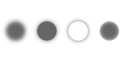 |
| [ ] | `shadow/path_star` | 128×128 | 3420 |  |
| [ ] | `shadow/radius_gt_half` | 128×128 | 2988 |  |
| [ ] | `shadow/translated_scaled` | 128×128 | 3265 |  |

## sprite

| ok | case | size | bytes | image |
|---|---|---|---|---|
| [ ] | `sprite/grid_1000` | 128×96 | 773 | 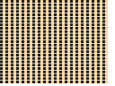 |
| [ ] | `sprite/rotated_scaled` | 128×96 | 4240 |  |

## stress

| ok | case | size | bytes | image |
|---|---|---|---|---|
| [ ] | `stress/clips_8deep_x100` | 1920×1080 | 42139 | 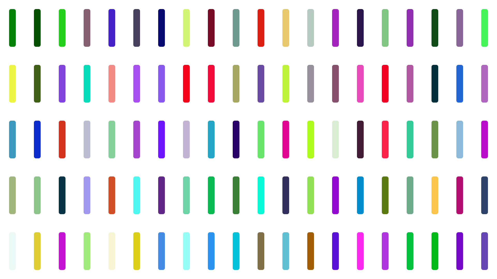 |
| [ ] | `stress/hairline_grid_dense` | 1920×1080 | 14020 | 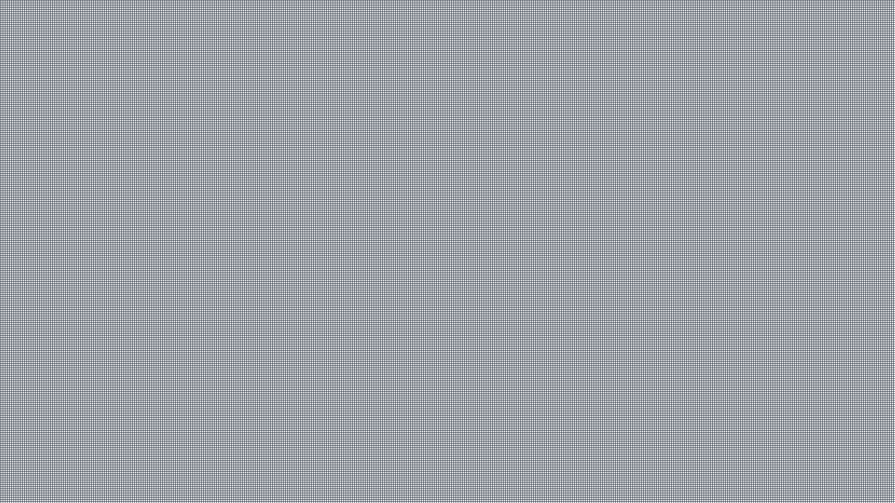 |
| [ ] | `stress/huge_path_100k_segments` | 1920×1080 | 32635 |  |
| [ ] | `stress/rects_10k` | 1920×1080 | 205931 | 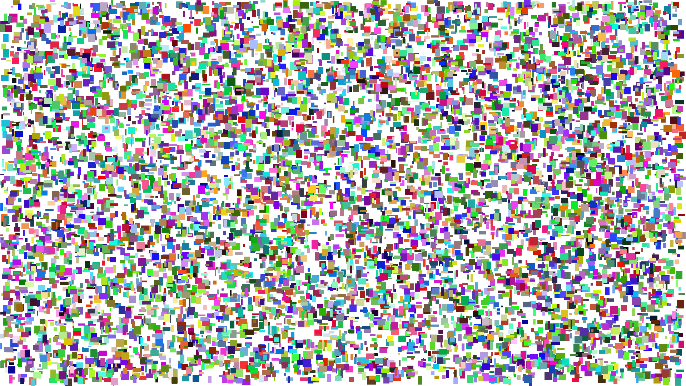 |

## stroke

| ok | case | size | bytes | image |
|---|---|---|---|---|
| [ ] | `stroke/caps` | 128×128 | 526 |  |
| [ ] | `stroke/caps_s125` | 160×160 | 809 |  |
| [ ] | `stroke/caps_s150` | 192×192 | 846 |  |
| [ ] | `stroke/caps_s175` | 224×224 | 1210 |  |
| [ ] | `stroke/caps_s200` | 256×256 | 1379 |  |
| [ ] | `stroke/closed_rrect_border` | 128×128 | 1060 | 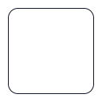 |
| [ ] | `stroke/closed_rrect_border_s125` | 160×160 | 1329 | 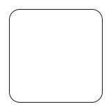 |
| [ ] | `stroke/closed_rrect_border_s150` | 192×192 | 1801 |  |
| [ ] | `stroke/closed_rrect_border_s175` | 224×224 | 2322 | 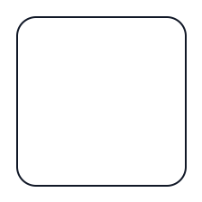 |
| [ ] | `stroke/closed_rrect_border_s200` | 256×256 | 2745 |  |
| [ ] | `stroke/curve` | 128×128 | 2268 |  |
| [ ] | `stroke/curve_s125` | 160×160 | 2905 | 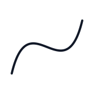 |
| [ ] | `stroke/curve_s150` | 192×192 | 3591 | 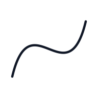 |
| [ ] | `stroke/curve_s175` | 224×224 | 4342 | 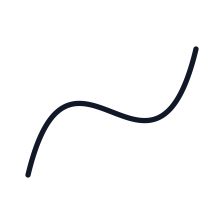 |
| [ ] | `stroke/curve_s200` | 256×256 | 4969 | 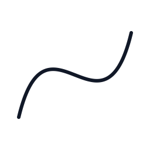 |
| [ ] | `stroke/dashes` | 128×128 | 3871 |  |
| [ ] | `stroke/dashes_s125` | 160×160 | 5810 |  |
| [ ] | `stroke/dashes_s150` | 192×192 | 6834 |  |
| [ ] | `stroke/dashes_s175` | 224×224 | 8868 |  |
| [ ] | `stroke/dashes_s200` | 256×256 | 9029 |  |
| [ ] | `stroke/hairline_grid` | 128×128 | 433 |  |
| [ ] | `stroke/hairline_grid_s125` | 160×160 | 619 |  |
| [ ] | `stroke/hairline_grid_s150` | 192×192 | 694 |  |
| [ ] | `stroke/hairline_grid_s175` | 224×224 | 923 |  |
| [ ] | `stroke/hairline_grid_s200` | 256×256 | 1004 |  |
| [ ] | `stroke/joins` | 128×128 | 1680 |  |
| [ ] | `stroke/joins_s125` | 160×160 | 2027 |  |
| [ ] | `stroke/joins_s150` | 192×192 | 3714 |  |
| [ ] | `stroke/joins_s175` | 224×224 | 4582 |  |
| [ ] | `stroke/joins_s200` | 256×256 | 5148 |  |
| [ ] | `stroke/miter_limit` | 128×128 | 1636 |  |
| [ ] | `stroke/miter_limit_s125` | 160×160 | 2029 |  |
| [ ] | `stroke/miter_limit_s150` | 192×192 | 4193 |  |
| [ ] | `stroke/miter_limit_s175` | 224×224 | 5280 |  |
| [ ] | `stroke/miter_limit_s200` | 256×256 | 6039 |  |
| [ ] | `stroke/under_nonuniform_scale` | 128×128 | 1070 |  |
| [ ] | `stroke/under_nonuniform_scale_s125` | 160×160 | 1347 |  |
| [ ] | `stroke/under_nonuniform_scale_s150` | 192×192 | 1601 |  |
| [ ] | `stroke/under_nonuniform_scale_s175` | 224×224 | 2091 |  |
| [ ] | `stroke/under_nonuniform_scale_s200` | 256×256 | 2400 |  |
| [ ] | `stroke/under_rotation` | 128×128 | 3679 |  |
| [ ] | `stroke/under_rotation_s125` | 160×160 | 4848 |  |
| [ ] | `stroke/under_rotation_s150` | 192×192 | 5903 |  |
| [ ] | `stroke/under_rotation_s175` | 224×224 | 7092 |  |
| [ ] | `stroke/under_rotation_s200` | 256×256 | 8398 |  |
| [ ] | `stroke/widths` | 128×128 | 1617 |  |
| [ ] | `stroke/widths_s125` | 160×160 | 2116 |  |
| [ ] | `stroke/widths_s150` | 192×192 | 2254 |  |
| [ ] | `stroke/widths_s175` | 224×224 | 3186 |  |
| [ ] | `stroke/widths_s200` | 256×256 | 3319 |  |

## text

| ok | case | size | bytes | image |
|---|---|---|---|---|
| [ ] | `text/bidi_mixed` | 480×320 | 5269 |  |
| [ ] | `text/cjk` | 480×320 | 7121 |  |
| [ ] | `text/colored_runs` | 480×320 | 5566 |  |
| [ ] | `text/colr_foreground` | 160×160 | 400 |  |
| [ ] | `text/colr_v0_layers` | 160×160 | 1447 |  |
| [ ] | `text/colr_v0_rotated` | 160×160 | 2811 |  |
| [ ] | `text/colr_v1_composite` | 160×160 | 393 |  |
| [ ] | `text/colr_v1_gradient` | 160×160 | 668 |  |
| [ ] | `text/decorations` | 480×320 | 5706 |  |
| [ ] | `text/decorations_all_styles` | 480×320 | 17444 |  |
| [ ] | `text/dense_paragraph` | 480×320 | 39124 |  |
| [ ] | `text/ellipsis_maxlines` | 480×320 | 8841 |  |
| [ ] | `text/emoji_color` | 480×320 | 14287 |  |
| [ ] | `text/glyph_run_synthetic` | 480×320 | 21899 |  |
| [ ] | `text/italic_synth` | 480×320 | 6073 |  |
| [ ] | `text/large_96` | 640×160 | 10814 |  |
| [ ] | `text/latin_sizes` | 480×320 | 25818 |  |
| [ ] | `text/latin_sizes_s125` | 600×400 | 35363 |  |
| [ ] | `text/latin_sizes_s150` | 720×480 | 43450 |  |
| [ ] | `text/latin_sizes_s175` | 840×560 | 53149 |  |
| [ ] | `text/latin_sizes_s200` | 960×640 | 65826 |  |
| [ ] | `text/mixed_scripts_fallback` | 480×320 | 5057 |  |
| [ ] | `text/mono_tabs` | 480×320 | 4101 |  |
| [ ] | `text/partially_offscreen_top` | 480×320 | 4486 |  |
| [ ] | `text/rotated_30` | 480×320 | 5717 |  |
| [ ] | `text/rtl_arabic` | 480×320 | 3848 |  |
| [ ] | `text/rtl_hebrew` | 480×320 | 3257 |  |
| [ ] | `text/scaled_transform_3x` | 480×320 | 1326 |  |
| [ ] | `text/selection_caret` | 480×320 | 2614 |  |
| [ ] | `text/serif` | 480×320 | 18536 |  |
| [ ] | `text/shadow_blur` | 320×96 | 9519 |  |
| [ ] | `text/shadows_and_background` | 480×320 | 20947 |  |
| [ ] | `text/subpixel_positions` | 480×320 | 1922 |  |
| [ ] | `text/subpixel_positions_s125` | 600×400 | 2591 |  |
| [ ] | `text/subpixel_positions_s150` | 720×480 | 3132 |  |
| [ ] | `text/subpixel_positions_s175` | 840×560 | 3959 |  |
| [ ] | `text/subpixel_positions_s200` | 960×640 | 5219 |  |
| [ ] | `text/tiny_6px` | 480×320 | 2927 |  |
| [ ] | `text/two_fonts_same_glyph_ids` | 480×320 | 12587 |  |
| [ ] | `text/weights` | 480×320 | 26519 |  |

## widget

| ok | case | size | bytes | image |
|---|---|---|---|---|
| [ ] | `widget/button_variants_default` | 480×320 | 8450 |  |
| [ ] | `widget/button_variants_material` | 480×320 | 14110 |  |
| [ ] | `widget/button_variants_tailwind` | 480×320 | 10020 |  |
| [ ] | `widget/calendar` | 480×320 | 12877 |  |
| [ ] | `widget/card_grid` | 480×320 | 8969 |  |
| [ ] | `widget/chips` | 480×320 | 2942 |  |
| [ ] | `widget/data_table` | 480×320 | 12162 |  |
| [ ] | `widget/dialog_over_scrim` | 480×320 | 5259 |  |
| [ ] | `widget/list_tiles_divider` | 480×320 | 12869 |  |
| [ ] | `widget/popover_open` | 480×320 | 2625 |  |
| [ ] | `widget/sheet_open` | 480×320 | 2353 |  |
| [ ] | `widget/spinner_settled` | 480×320 | 2331 |  |
| [ ] | `widget/tabs` | 480×320 | 2630 |  |
| [ ] | `widget/text_field_states` | 480×320 | 5051 |  |
| [ ] | `widget/toast_shown` | 480×320 | 2353 |  |
| [ ] | `widget/toggles` | 480×320 | 4766 |  |
| [ ] | `widget/tooltip_visible` | 480×320 | 2257 |  |

## xform

| ok | case | size | bytes | image |
|---|---|---|---|---|
| [ ] | `xform/mirror_x` | 128×128 | 1664 |  |
| [ ] | `xform/nested_append` | 128×128 | 2705 |  |
| [ ] | `xform/rotate_15` | 128×128 | 3813 |  |
| [ ] | `xform/rotate_45` | 128×128 | 3477 |  |
| [ ] | `xform/rotate_90` | 128×128 | 3108 |  |
| [ ] | `xform/scale_10x_circle` | 128×128 | 299 |  |
| [ ] | `xform/skew_x_0_3` | 128×128 | 1638 |  |
